# Study Report — Week 6: LSTM Networks for Time-Series Forecasting

| | |
|---|---|
| **Course** | AI/ML Class — Week 6 assignment |
| **Topic** | Recurrent neural networks: the **LSTM** (Long Short-Term Memory), built from scratch |
| **Problem** | Predict **tomorrow's minimum temperature in Stockholm, Sweden** from the 14 days before it (time-series regression) |
| **Dataset** | [Weather prediction dataset](https://github.com/florian-huber/weather_prediction_dataset) (Stockholm columns, 2000–2009), built from ECA&D station data |
| **Tools** | Python 3.11, NumPy (the LSTM itself), pandas, PyTorch (maths check + "library way"), scikit-learn (linear baseline), plotext (charts in the terminal), matplotlib (the same charts as PNGs) |
| **Result** | LSTM test MAE **1.587 °C** (persistence 1.680, linear regression 1.624, Week 5 network 1.620). With each day's weather added and 5 LSTMs averaged: **1.297 °C**, R² = 0.930 (Week 5 best: 1.312) |
| **Date** | 20 Nov 2026 |

---

## Table of contents
1. [The big picture (end-to-end)](#1-the-big-picture-end-to-end)
2. [The dataset](#2-the-dataset)
3. [Data processing & transformation, step by step](#3-data-processing--transformation-step-by-step)
4. [The model: LSTM — basics and architecture](#4-the-model-lstm--basics-and-architecture)
5. [The mathematics of an LSTM](#5-the-mathematics-of-an-lstm)
6. [Training with a validation set](#6-training-with-a-validation-set)
7. [Model evaluation](#7-model-evaluation)
8. [How to improve the model](#8-how-to-improve-the-model)
9. [Evolution, current state, open problems](#9-evolution-current-state-open-problems)
10. [Why this matters for my roles](#10-why-this-matters-for-my-roles)
11. [Glossary](#11-glossary)
12. [Check my understanding](#12-check-my-understanding)
13. [References](#13-references)

---

## 1. The big picture (end-to-end)

```
 ┌──────────┐  ┌──────────────┐  ┌────────────┐  ┌────────────┐  ┌──────────────┐  ┌────────────┐  ┌──────────────┐  ┌───────────┐
 │ 1. LOAD  │─►│ 2. CLEAN     │─►│ 3. SEASON  │─►│ 4. SCALE   │─►│ 5. WINDOW    │─►│ 6. SPLIT   │─►│ 7. TRAIN     │─►│ 8. EVAL   │
 │ CSV,     │  │ impossible   │  │ day of year│  │ mean 0,    │  │ 14 days IN   │  │ by answer  │  │ forward 14   │  │ test set, │
 │ Stockholm│  │ values → NaN │  │ → sin, cos │  │ std 1      │  │ ORDER → next │  │ date       │  │ days → loss →│  │ baselines,│
 │ columns  │  │ → interpolate│  │            │  │ (train     │  │ day          │  │ 60│20│20 % │  │ BPTT → Adam  │  │ errors,   │
 │ 3,653 d  │  │ 35 fixed     │  │ 3 features │  │ stats only)│  │ (n, 14, 3)   │  │ train│val│ │  │ early stop   │  │ influence │
 └──────────┘  └──────────────┘  └────────────┘  └────────────┘  └──────────────┘  └────────────┘  └──────────────┘  └───────────┘
   step 1          step 1/2          step 2          step 2           step 2           step 2      step 3 (maths),      step 5, 6
                                                                                                    step 4 (real)
```

| Step | Script | Input → Output | Key idea |
|---|---|---|---|
| 1 | `step1_explore.py` | CSV → understanding | Look before you model: hidden bad values, seasons, how long the weather "remembers" |
| 2 | `step2_sequences.py` | daily table → 3-D array `X (samples, days, features)` | An LSTM reads the days **in order**, one at a time |
| 3 | `step3_lstm_from_scratch.py` | toy numbers → every formula | Gates, cell state, BPTT by hand; checked by brute force **and** by PyTorch |
| 4 | `step4_train.py` | train + val → `models/lstm.npz` | Mini-batch BPTT + Adam; validation decides when to stop |
| 5 | `step5_evaluate.py` | model + test → scores | Compare with baselines; look at which past days the model uses |
| 6 | `step6_improve.py` | experiments → winner → test once | New information beats a bigger or fancier model |
| — | `lstm.py` | — | The model itself: ~100 lines of NumPy |

> **Web-dev analogy:** Week 5's network was a **pure function**: one row in, one number out. This week's LSTM is a **reducer**: `days.reduce(cell, {c: 0, h: 0})`. It walks through the days one by one and updates a piece of state, exactly like `useReducer` or a Redux store processes a list of actions. The prediction is computed from the final state.

---

## 2. The dataset

- **Source:** the [Weather prediction dataset](https://github.com/florian-huber/weather_prediction_dataset) by Huber et al., made for teaching machine learning. It is built from [ECA&D](https://www.ecad.eu) (European Climate Assessment & Dataset) station records.
- **Licence:** **CC BY 4.0** for the [dataset on Zenodo](https://doi.org/10.5281/zenodo.7525955) and **MIT** for the GitHub repo. It is free to use, but you must credit the source.
- **Set-up (same as Week 5):** the raw file sits in `data/weather_prediction_dataset.csv` (3,654 rows × 165 columns, 18 European cities, 2000-01-01 to 2010-01-01). `common.load_raw()` keeps only Stockholm's 7 columns, renames them (`STOCKHOLM_temp_min` → `temp_min`), parses the date, and stops at 2009-12-31: **3,653 days**, exactly 10 years.

| Column | Meaning | Unit | Mean | Std | Min | Max |
|---|---|---|---|---|---|---|
| `temp_min` ⭐ **target** | the day's minimum temperature | °C | 5.11 | 7.25 | −19.7 | 21.2 |
| `temp_mean` | daily mean temperature | °C | 8.05 | 7.83 | −17.0 | 26.2 |
| `temp_max` | daily maximum temperature | °C | 11.48 | 8.95 | −14.5 | 32.9 |
| `pressure` | air pressure | 1000 hPa (1.012 = 1012 hPa) | 1.012 | 0.012 | 0.969 | 1.051 |
| `cloud_cover` | sky covered by clouds | eighths (oktas): 0 clear, 8 overcast | 5.30 | 2.32 | 0 | 8 |
| `sunshine` | hours of sunshine | hours | 5.16 | 4.91 | 0 | 17.8 |
| `precipitation` | rain/snow | cm | 0.15 | 0.35 | 0 | 4.3 |

*(Statistics after cleaning.)*

**Task:** regression, which means predicting a number rather than a category. Given the 14 days up to the end of day *t−1*, predict `temp_min` on day *t*.

### 2.1 Data quality: hidden missing values

| Check | Result |
|---|---|
| Missing calendar days | **0** (3,653 days, 3,653 rows) |
| Empty cells (NaN) | **0** |
| **Impossible values** | **35**: `cloud_cover` = −99 and 9 (3×), `pressure` = −0.099 (3×), `sunshine` = −1.7 hours (29×) |

The file *looks* complete, but some missing readings are stored as **sentinel values**: special numbers that mean "no data", like −99. They pass every "is it empty?" check and then silently poison the maths.

> **Frontend analogy:** an API that returns `-1` or `"N/A"` instead of `null`. Nothing crashes; you just compute nonsense.

**Fix (`common.clean`):** each column has a physically possible range (`VALID_RANGES`). Values outside it become NaN, `asfreq("D")` guarantees one row per calendar day, and **linear interpolation** fills each gap with a straight line between its neighbours.

**Why this matters even more for an LSTM:** the LSTM treats "next row" as "next day". If one day were missing, every sequence crossing it would silently be one day off. Gap-free, evenly spaced data is a hard requirement for sequence models.

### 2.2 A strong yearly cycle, no trend

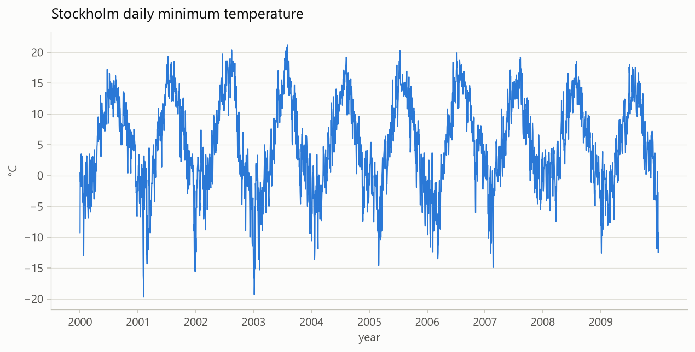

| Month | Jan | Feb | Mar | Apr | May | Jun | Jul | Aug | Sep | Oct | Nov | Dec |
|---|---|---|---|---|---|---|---|---|---|---|---|---|
| Avg min °C | −2.6 | **−3.2** | −1.6 | 2.8 | 7.4 | 11.6 | **14.9** | 14.5 | 10.2 | 5.6 | 2.0 | −0.9 |

Yearly averages move between 4.7 and 5.8 °C with no steady rise or fall: no trend to model. The **season** is the big pattern.

### 2.3 How long does the weather "remember"? (choosing the sequence length)

**Autocorrelation** = how strongly a series correlates with a delayed copy of itself (+1 identical, 0 unrelated).

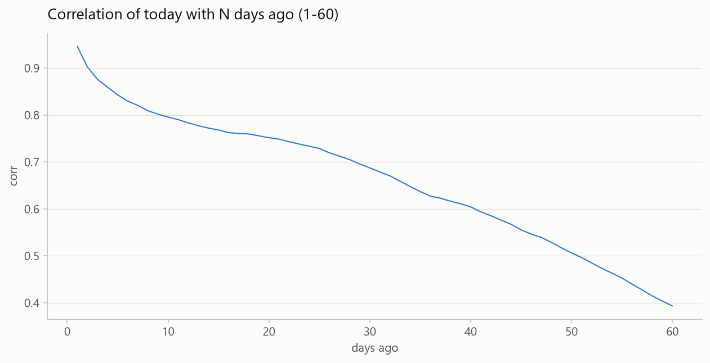

| Today vs … days ago | 1 | 2 | 3 | 7 | 14 | 30 | 60 |
|---|---|---|---|---|---|---|---|
| raw series | **+0.95** | +0.90 | +0.88 | +0.82 | +0.77 | +0.69 | +0.39 |
| **season removed** | **+0.75** | +0.55 | +0.44 | +0.22 | +0.09 | +0.06 | |

The raw correlation stays high for weeks, but most of that is just the **season** ("a cold day sits inside a cold month"). Removing the average yearly curve shows the real day-to-day memory of the weather: strong for 2–3 days, almost gone after **~2 weeks**.

Two design decisions follow:
- **Season as an input:** give the LSTM the day of the year directly (section 3.2), so it doesn't have to "remember" a whole season.
- **Sequence length 14 days** to start with; step 6 tests 7 and 30.

### 2.4 Do the other measurements help?

Correlation of **yesterday's** value with **today's** `temp_min`: `temp_mean` +0.96, `temp_max` +0.93, `sunshine` +0.40, `cloud_cover` −0.13, `precipitation` +0.10, `pressure` +0.03.

A low correlation does **not** mean useless: correlation only measures a straight-line link on its own. "High pressure + clear sky in winter" means a cold night, a *combination* a neural network can learn. Step 6 adds these six columns to every day of the sequence.

### 2.5 Very different number sizes

Pressure lives around 1.0 (std 0.012), temperatures span −20 to +33, sunshine 0 to 18. Section 3.3 shows why an LSTM is especially sensitive to this.

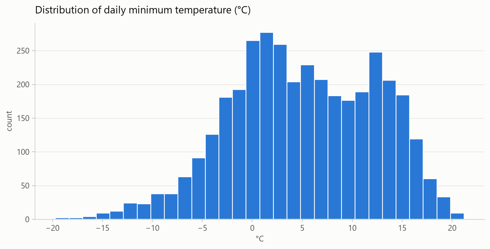

---

## 3. Data processing & transformation, step by step

### Step 3.1 Clean (`common.clean`)
Impossible values → NaN → `asfreq("D")` (one row per calendar day) → `interpolate()`. **Result:** 3,653 days, 0 gaps, 0 impossible values.

### Step 3.2 Season on a circle (`common.add_season`)

Day-of-year as a plain number (1…366) makes Dec 31 and Jan 1 look 364 apart. On a circle, like a clock hand, they are neighbours:

```
angle = 2π · day_of_year / 365.25        doy_sin = sin(angle)      doy_cos = cos(angle)
```

| Date | doy_sin | doy_cos |
|---|---|---|
| Jan 1 | +0.02 | +1.00 |
| Apr 1 | +1.00 | +0.01 |
| Jul 1 | +0.01 | −1.00 |
| Oct 1 | −1.00 | +0.00 |
| Dec 31 | −0.00 | +1.00 ≈ Jan 1 ✔ |

Every day is now a **feature vector** (a short list of numbers describing one item) of 3 numbers: `[temp_min, doy_sin, doy_cos]`.

### Step 3.3 Standardization (scaling), train statistics only

```
x_scaled = (x − mean_train) / std_train          mean, std computed on 2000–2005 ONLY
```

| Column | train mean | train std |
|---|---|---|
| temp_min | 5.052 | 7.468 |
| doy_sin | 0.000 | 0.707 |
| doy_cos | 0.000 | 0.707 |

**Example:** 2000-01-01 `temp_min` = −9.3 °C → (−9.3 − 5.052) / 7.468 = **−1.922**, "about two typical steps colder than average".

**Why the LSTM needs this:** its gates use **sigmoid** and **tanh**, S-shaped curves that go flat for large inputs (σ(10) ≈ σ(20) ≈ 1).

```
 σ(z)  1 ┤                ___________      flat → gradient ≈ 0 → "stuck"
         │             __/
     0.5 ┤          __/      ← sensitive middle: here the gate can learn
         │       __/
       0 ┤______/                          flat → gradient ≈ 0 → "stuck"
         └──────┬──────┬──────┬──────
              −5      0      +5      z
```

Raw inputs like 1012 hPa would push gates onto the flat parts, where the slope is ~0 and nothing is learned. Scaled inputs keep them in the sensitive middle.

**The target is scaled the same way** (it *is* `temp_min`, just one day later). Predictions convert back with `°C = ŷ × 7.468 + 5.052`.

**Leakage rule:** mean and std come from the training years only. Using 2008–2009 statistics would let information about the "future" leak into training.

### Step 3.4 The sliding window, now as a SEQUENCE (`common.make_sequences`)

This is the big change from Week 5:

```
WEEK 5 (feedforward): the past is FLATTENED into one row of numbers
   [lag_7, lag_6, lag_5, lag_4, lag_3, lag_2, lag_1, doy_sin, doy_cos]  →  network  →  ŷ
   The network doesn't know lag_1 comes "after" lag_2. They are just columns 7 and 6.

WEEK 6 (LSTM): the past stays a SEQUENCE, read in order, one day per step
   day t−14: [temp, sin, cos] ──► cell ──► cell ──► … ──► cell ◄── day t−1: [temp, sin, cos]
                                   ▲        ▲               │
                                day t−13  day t−12          └──► ŷ
```

Each **sample** is a small table of 14 rows (days, also called **time steps**) × 3 columns (features). The first sample:

```
             temp_min  doy_sin  doy_cos        (scaled)
2000-01-01     -1.92     0.02     1.41   ← time step 1 (oldest)
2000-01-02     -0.61     0.05     1.41
   …
2000-01-14     -0.82     0.34     1.37   ← time step 14 (yesterday)
answer: temp_min on 2000-01-15 = -1.145 (= -3.5 °C)
```

The next sample is the same window moved **one day later** (days Jan 2 – Jan 15 → answer Jan 16), and so on. The first 14 days can't be answers (no full window before them): 3,653 days → **3,639 samples**.

> **Data leakage check:** every input day is *before* the answer day. In step 6 the sequence also includes each day's `temp_mean`, `pressure`, etc. That's safe for the same reason: the newest day in the window is yesterday, never the answer day.

### Step 3.5 Split by the date of the answer

| Split | Answer dates | Samples | Share | Used for |
|---|---|---|---|---|
| **Train** | 2000-01-15 → 2005-12-31 | 2,178 | 60% | learning the weights |
| **Validation** | 2006-01-01 → 2007-12-31 | 730 | 20% | watched every epoch; early stopping; choosing settings in step 6 |
| **Test** | 2008-01-01 → 2009-12-31 | 731 | 20% | the final honest score |

```
2000 ─────────────────────── 2005 │ 2006 ──── 2007 │ 2008 ──── 2009
           TRAIN (learn)           │ VALIDATION      │ TEST (final exam)
                        └─14 days─┘▲ the first validation sample reads late-December 2005: allowed,
                                     on 1 Jan 2006 you really would know the last two weeks.
```

**What is validation data for?** It is a "practice exam" the model never trains on. We use it to (1) see whether the model is overfitting, (2) decide *when to stop training* (early stopping), and (3) *choose settings* (hidden size, learning rate, inputs) in step 6. Because we make decisions with it, its score becomes slightly optimistic, so we keep a separate **test** set that we use only once, at the very end.

A **random** split would be wrong for time series: the model could train on 5 March 2008 and be tested on 4 March 2008, whose 14-day window it has mostly seen already.

### Step 3.6 Final arrays

| Array | Shape | Meaning |
|---|---|---|
| `X_train` | **(2178, 14, 3)** | 2,178 samples × 14 days × 3 features = 91,476 numbers |
| `y_train` | (2178, 1) | one answer per sample |
| `X_val`, `y_val` | (730, 14, 3), (730, 1) | |
| `X_test`, `y_test` | (731, 14, 3), (731, 1) | |

```
           features →
         ┌──────────────┐
    day  │ t-14 ...     │┐
     ↓   │ ...          ││┐      2,178 samples stacked = a 3-D array
         │ t-1  ...     │││      (samples, time steps, features)
         └──────────────┘││      This 3-D shape is what every LSTM library expects
          └──────────────┘│      (PyTorch with batch_first=True, Keras by default).
           └──────────────┘
```

---

## 4. The model: LSTM — basics and architecture

### 4.1 From "no memory" to "memory" to "smart memory"

```
 FEEDFORWARD (Week 5)          SIMPLE RNN (1980s)                 LSTM (1997)
 ────────────────────          ──────────────────                 ───────────
   x ──► [ net ] ──► ŷ           x_t ──► [ cell ] ──► h_t            x_t ──► [ cell with gates ] ──► h_t
                                           ▲    │                              ▲   ▲      │   │
   no memory: each row           h_{t-1} ──┘    └─► next step       h_{t-1} ──┘   │      │   └─► next step
   stands alone                  one memory vector, fully           c_{t-1} ──────┘      └─────► c_t
                                 OVERWRITTEN every step             two memories; gates decide what to
                                                                    forget, what to write, what to show
```

- **Recurrent neural network (RNN):** a network with a loop. It processes one step of a sequence at a time and passes a **hidden state** `h` (a vector of numbers, its "memory") to the next step. The same weights are used at every step.
- **The problem with a simple RNN:** it rewrites its whole memory every step, and when we train it, the learning signal from early steps **shrinks exponentially** on its way back (the *vanishing gradient*, section 5.6). In practice it can't learn from more than ~5–10 steps back.
- **LSTM (Long Short-Term Memory):** an RNN cell with a second memory, the **cell state** `c`, and three **gates** (learned on/off valves with values between 0 and 1) that control it. Because the cell state is changed by *multiplying with a gate and adding*, not by rewriting, information and learning signals can flow across many steps.

### 4.2 Inside one LSTM cell (visual architecture)

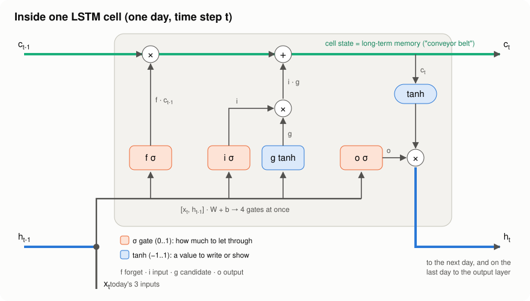

| Part | Formula (per day) | Range | Plain words | Frontend analogy |
|---|---|---|---|---|
| **forget gate** f | σ(…) | 0..1 | how much of the old memory to **keep** (1 = keep all, 0 = wipe) | cache eviction / TTL |
| **input gate** i | σ(…) | 0..1 | how much of the new information to **write** | "save changes?" permission |
| **candidate** g | tanh(…) | −1..1 | **what** new information could be written | the form's new values |
| **output gate** o | σ(…) | 0..1 | how much of the memory to **show** as `h` | which state is rendered |
| **cell state** c | f·c_prev + i·g | any | the long-term memory ("conveyor belt") | the store |
| **hidden state** h | o·tanh(c) | −1..1 | the short-term output of this step | the rendered view (derived state) |

All four gates look at the **same two things**: today's input `x_t` and yesterday's output `h_{t−1}`. Each has its own weights, so each learns a different job.

> **Frontend analogy, in one picture:** `c` is a Redux store that persists across actions. Each day is an action. The forget gate is a selective "reset" for parts of the store, the input gate decides which fields of the new payload get committed, and the output gate is a selector that decides what the UI (`h`) shows. All three policies are *learned* from data instead of written by hand.

### 4.3 The LSTM unrolled over 14 days

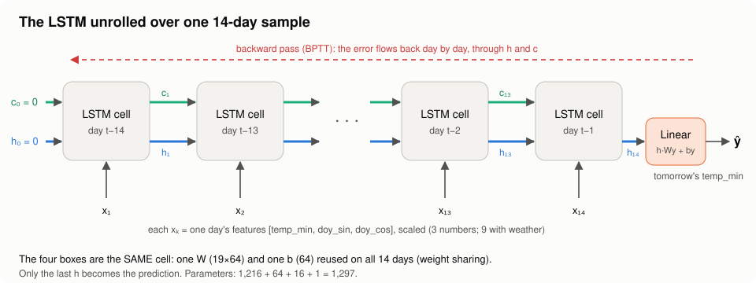

- "**Unrolling**" means drawing the loop as a chain, one copy per time step. It's the same cell (same weights) 14 times. This is called **weight sharing**.
- Only the **last** hidden state `h₁₄` is used for the prediction (a "many-to-one" set-up). A **linear output layer** (no activation, because temperature can be any number) turns the 16 numbers of `h₁₄` into one number ŷ.
- Weight sharing means a 30-day window needs **no extra weights**. Week 5's network needed a new set of weights for every extra lag.

### 4.4 Our network in numbers

| Part | Shape | Parameters |
|---|---|---|
| `W` (all 4 gates, applied to `[x_t, h_{t−1}]`) | (3 + 16) × (4 × 16) = 19 × 64 | 1,216 |
| `b` (4 gates' biases) | 64 | 64 |
| `Wy` (output layer) | 16 × 1 | 16 |
| `by` | 1 | 1 |
| **Total** | | **1,297** |

### 4.5 Hyperparameters (settings we choose; the LSTM learns the weights)

| Setting | Value | Meaning |
|---|---|---|
| `WINDOW` | 14 | days per sequence (time steps) |
| `FEATURES` | temp_min, doy_sin, doy_cos | numbers per day (9 with weather in step 6) |
| `HIDDEN` | 16 | memory size: `h` and `c` each hold 16 numbers |
| `LEARNING_RATE` | 0.005 | Adam's step size |
| `BATCH_SIZE` | 32 | sequences per weight update |
| `EPOCHS` | 80 (max) | passes over the training data |
| `PATIENCE` | 10 | early stopping: stop after 10 epochs with no validation improvement |
| `CLIP` | 1.0 | gradient clipping: the longest allowed update direction |
| `SEED` | 42 | fixes the random numbers so every run is reproducible |

---

## 5. The mathematics of an LSTM

### 5.1 Notation

| Symbol | Meaning | Shape (our LSTM) |
|---|---|---|
| **x_t** | the input features of day t | 3 |
| **h_t** | hidden state after day t (short-term memory / output) | 16 |
| **c_t** | cell state after day t (long-term memory) | 16 |
| **[x_t, h_{t−1}]** | the two glued together side by side ("concatenated") | 19 |
| **W, b** | gate weights and biases (4 gates side by side) | 19×64, 64 |
| **i, f, g, o** | input gate, forget gate, candidate, output gate | 16 each |
| **σ** | sigmoid: σ(z) = 1 / (1 + e^(−z)), squashes to (0, 1) | |
| **tanh** | hyperbolic tangent, squashes to (−1, 1) | |
| **⊙** | element-by-element multiplication | |
| **Wy, by** | output layer | 16×1, 1 |
| **T** | days per sequence | 14 |
| **ŷ, y, L** | prediction, true answer, loss | 1, 1, 1 number |

### 5.2 Forward pass (making a prediction)

Start with empty memory, `h₀ = 0`, `c₀ = 0`. Then for every day t = 1 … 14:

```
z_t = [x_t, h_{t−1}] · W + b              one matrix multiplication → 64 numbers
i_t = σ(z_t[ 0:16])                        input gate      (how much to write)
f_t = σ(z_t[16:32])                        forget gate     (how much to keep)
g_t = tanh(z_t[32:48])                     candidate       (what to write)
o_t = σ(z_t[48:64])                        output gate     (how much to show)

c_t = f_t ⊙ c_{t−1} + i_t ⊙ g_t           update the long-term memory
h_t = o_t ⊙ tanh(c_t)                      this day's output
```

After the last day:

```
ŷ = h_T · Wy + by
```

In code (`lstm.py → forward`), each line runs for **a whole batch at once**: `X[:, t]` is (32, 3), so `xh @ W` is (32, 64).

**Two details:**
- **Forget-gate bias = 1 at the start.** σ(1) ≈ 0.73, so a fresh LSTM begins by *remembering*. This classic trick (Gers et al., 2000; Jozefowicz et al., 2015) speeds up learning.
- **Gate order i, f, g, o** is PyTorch's order, so we can copy our weights into `torch.nn.LSTM` and get identical outputs (section 5.8).

### 5.3 Loss

Mean squared error over the n sequences of a batch:

```
L = (1/n) · Σ (ŷᵢ − yᵢ)²
```

Because `y` is standardized, **L = 1.0 means "as bad as always guessing the average"**, and L = 0 is perfect.

### 5.4 Worked example: one memory cell reads 3 days (step 3, part A)

One feature, one memory cell (H = 1), three scaled temperatures `x = [1.0, 0.5, −0.5]` (a warm spell cooling down), true answer `y = −0.8` (colder still). Hand-picked weights, one number per gate:

| | i | f | g | o |
|---|---|---|---|---|
| w_x (input weight) | 0.5 | 0.0 | 1.0 | 0.5 |
| w_h (memory weight) | 0.0 | 0.5 | 0.5 | 0.0 |
| b (bias) | 0.0 | 1.0 | 0.0 | 0.0 |

Output layer: `ŷ = 2·h₃`. Learning rate 0.3.

**Forward** (h₀ = c₀ = 0)

| Day | x | h_prev | i = σ(.) | f = σ(.) | g = tanh(.) | o = σ(.) | c = f·c_prev + i·g | h = o·tanh(c) |
|---|---|---|---|---|---|---|---|---|
| 1 | +1.0 | 0.0000 | 0.6225 | 0.7311 | +0.7616 | 0.6225 | 0.731·0 + 0.622·0.762 = **+0.4741** | **+0.2748** |
| 2 | +0.5 | 0.2748 | 0.5622 | 0.7572 | +0.5631 | 0.5622 | 0.757·0.474 + 0.562·0.563 = **+0.6755** | **+0.3309** |
| 3 | −0.5 | 0.3309 | 0.4378 | 0.7623 | −0.3226 | 0.4378 | 0.762·0.676 + 0.438·(−0.323) = **+0.3737** | **+0.1564** |

Check one by hand. Day 1, input gate: z = 0.5·1.0 + 0·0 + 0 = 0.5 → σ(0.5) = 1/(1+e^(−0.5)) = **0.6225** ✔.

```
ŷ = 2 · 0.1564 = +0.3128          true y = −0.8
L = (0.3128 − (−0.8))² = 1.2384
```

Read the gates: the forget gate (~0.73–0.76) keeps most of the old memory every day. On day 3 the candidate turns **negative** (it's getting colder), so the memory `c` drops from 0.68 to 0.37: the cell "notices" the cooling. But the prediction is still too warm.

**Backward through time** (chain rule, from the loss back to day 1)

```
dL/dŷ = 2(ŷ − y) = +2.2257        positive → the prediction is too HIGH, push it down
```

| Day (backwards) | dL/dh | dL/dc | dL/dz [i, f, g, o] |
|---|---|---|---|
| 3 | +4.4513 | +1.7002 | [−0.1350, +0.2081, +0.6669, +0.3914] |
| 2 | +0.4375 | +1.4568 | [+0.2019, +0.1270, +0.5593, +0.0634] |
| 1 | +0.3431 | +1.2750 | [+0.2282, **0.0000**, +0.3333, +0.0356] |

- On day 1, the forget gate gets **zero** blame: `c₀` was 0, so there was nothing to forget.
- `dL/dc` shrinks only gently as it travels back (1.70 → 1.46 → 1.28). On the cell path it is just multiplied by `f` each day. That's the LSTM's key property (section 5.6).
- Because the **same weights** are used every day, the gradients from the 3 days are **added up**:

```
dL/dw_x = [ 0.3967, −0.0406, 0.2795, −0.1284]     dL/dw_h = [0.0108, 0.1038, 0.3744, 0.1469]
dL/db   = [ 0.2951,  0.3351, 1.5595,  0.4904]     dL/dw_y = +0.3481        dL/db_y = +2.2257
```

**Update** (plain gradient descent: `new = old − 0.3 × gradient`)

```
w_x: [0.5, 0, 1, 0.5]  → [0.381, 0.012, 0.916, 0.539]
w_h: [0, 0.5, 0.5, 0]  → [−0.003, 0.469, 0.388, −0.044]
b:   [0, 1, 0, 0]      → [−0.089, 0.900, −0.468, −0.147]       w_y: 2 → 1.896     b_y: 0 → −0.668
```

**After one step:** ŷ = −0.7889 (target −0.8), L = 0.000123 (was 1.2384). The script confirms `lstm.py` produces exactly these gradients. A single sample is easy to fit in one step. Real training averages over 32 sequences per step and needs thousands of small steps.

### 5.5 Backpropagation through time (BPTT): the general formulas

**BPTT** = ordinary backpropagation applied to the unrolled chain of section 4.3. Start at the loss, walk the days backwards, and apply the chain rule to each line of the forward pass:

| From forward line | Backward rule | Plain words |
|---|---|---|
| ŷ = h_T·Wy + by | δ = dL/dŷ = 2(ŷ − y)/n;  dWy = h_Tᵀ·δ;  dh_T = δ·Wyᵀ | blame on the output, passed into the last h |
| h = o ⊙ tanh(c) | do = dh ⊙ tanh(c);  dc += dh ⊙ o ⊙ (1 − tanh²(c)) | h blames its two parents, o and c |
| c = f ⊙ c_prev + i ⊙ g | df = dc ⊙ c_prev;  di = dc ⊙ g;  dg = dc ⊙ i;  **dc_prev = dc ⊙ f** | the product rule, term by term |
| gates | dz = [di⊙i(1−i), df⊙f(1−f), dg⊙(1−g²), do⊙o(1−o)] | σ′ = σ(1−σ), tanh′ = 1 − tanh² |
| z = [x, h_prev]·W + b | dW **+=** [x, h_prev]ᵀ·dz;  db += Σdz;  [dx, dh_prev] = dz·Wᵀ | add up over days; pass blame to yesterday |

Two error signals travel back in time: **dh** (through the gates and W) and **dc** (through the forget gate only). The code (`lstm.py → backward`) is exactly this table inside a `for t in reversed(...)` loop.

> **Web-dev analogy:** BPTT is time-travel debugging, like Redux DevTools. The final state is wrong; you step back through every action (day) to see how much each one contributed to the bug, then fix the reducer (the weights) that handled all of them.

### 5.6 Why the LSTM works: the vanishing gradient (step 3, part D)

In a **simple RNN**, `h_t = tanh(w·h_{t−1} + u·x_t)`. Going back one day multiplies the error signal by `w · tanh′(z)`, typically something like 0.8 × 0.6 = **0.48**. Do that for k days and you get 0.48^k.

In an **LSTM**, the path back along the cell state is `dc_prev = dc ⊙ f`. Going back one day multiplies the signal by just the **forget gate**, which the LSTM can learn to hold near 1 (e.g. 0.95).

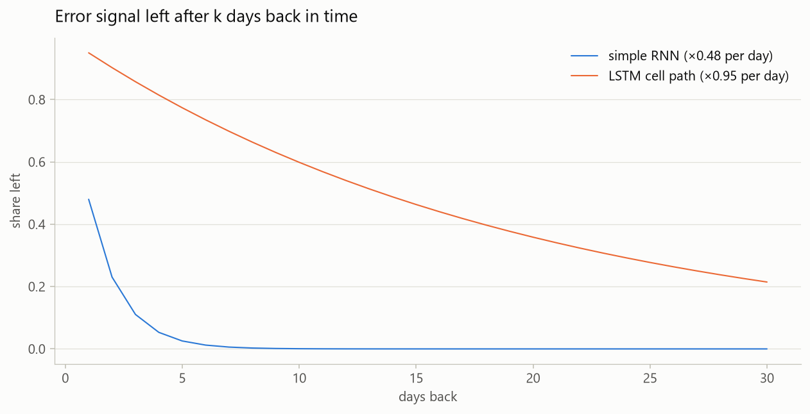

| Days back | 1 | 3 | 7 | 14 | 30 |
|---|---|---|---|---|---|
| simple RNN (×0.48 per day) | 0.48 | 0.11 | 0.0059 | **0.000034** | 2.7·10⁻¹⁰ |
| LSTM cell path (×0.95 per day) | 0.95 | 0.86 | 0.70 | **0.49** | 0.21 |

- A signal of 0.000034 means the simple RNN effectively **cannot learn** that something 14 days ago mattered.
- The LSTM's additive cell-state path was called the **"constant error carousel"** by its inventors (Hochreiter & Schmidhuber, 1997).
- If the per-step factor is **above 1**, the signal **explodes** instead. That's why we also use **gradient clipping** (section 5.9).

> **Analogy:** the simple RNN is the telephone game, where the message degrades with every person. The LSTM adds a written note passed along the line: each person can cross parts out (forget) or add to it (input), but nobody has to retell it from memory.

### 5.7 Gradient check: proof that BPTT is right (step 3, part B)

Estimate a slope without calculus by nudging one weight by a tiny ε and running two forward passes:

```
slope ≈ (L(w + ε) − L(w − ε)) / 2ε
```

On a real batch of 64 sequences:

| Weight | Brute force | BPTT |
|---|---|---|
| W[x = temp_min → input gate 4] | −0.01302656 | −0.01302656 |
| W[h₂ → forget gate 5] | +0.03523269 | +0.03523269 |
| b[candidate 9] | +0.01278853 | +0.01278853 |
| Wy[h₄ → output] | −1.08650181 | −1.08650181 |

They agree to 8 decimals. Brute force needs 2 forward passes **per weight** (2,594 for our 1,297 weights). BPTT gets them all in **one** backward pass.

### 5.8 Is it a "real" LSTM? Same output as PyTorch (step 3, part C)

We copy our `W` into PyTorch's `nn.LSTM` (split into `weight_ih` for the x part and `weight_hh` for the h part, transposed) and run both on the same 64 sequences:

```
ours   : [-0.0174 -0.0373 -0.0325 -0.0054 -0.0235]
PyTorch: [-0.0174 -0.0373 -0.0325 -0.0054 -0.0235]     largest difference 8.7e-08 (float32 rounding)
```

Same formulas, same gate order: our ~100 lines of NumPy **are** the industry-standard LSTM.

### 5.9 Training details: Adam and gradient clipping

**Gradient clipping.** Measure the length of the whole gradient (all 1,297 slopes as one vector). If it's longer than 1.0, shrink it to length 1.0, keeping its direction:

```
‖g‖ = √(Σ g²)          if ‖g‖ > clip:   g ← g · clip / ‖g‖
```

This protects against a rare exploding step that would throw the weights far away.

**Adam** (adaptive moment estimation) is the standard optimiser for LSTMs. Instead of one step size for all weights, it keeps two running averages per weight:

```
m ← 0.9 · m + 0.1 · g              smoothed direction ("momentum")
v ← 0.999 · v + 0.001 · g²         typical size of the gradient
m̂ = m / (1 − 0.9^t),  v̂ = v / (1 − 0.999^t)     bias correction (m, v start at 0)
w ← w − η · m̂ / (√v̂ + 10⁻⁸)
```

Dividing by √v̂ gives each weight its own step size: weights with consistently large gradients take careful steps, and weights with small gradients take relatively bigger ones. This matters for LSTMs, where gate weights receive very different gradient sizes.

> **Analogy:** plain gradient descent is one global CSS `font-size`. Adam is responsive typography: each element scales according to its own context.

### 5.10 The whole algorithm in 9 lines

```
1. Initialise W, Wy randomly (std 1/√inputs); biases 0, forget-gate bias 1.
2. For each epoch (≤ 80):
3.     Shuffle the 2,178 training sequences; split into batches of 32.
4.     For each batch:
5.         h, c = 0;  for day 1..14:  gates → c → h          (5.2)  forward
6.         ŷ = h·Wy + by;   dL/dŷ = 2(ŷ − y)/n               (5.3)  loss gradient
7.         for day 14..1:  BPTT, add up gradients            (5.5)  backward
8.         clip the gradient; Adam update of all weights     (5.9)
9.     Measure train/val loss; keep the best; stop after 10 epochs without improvement.
```

---

## 6. Training with a validation set

### 6.1 Before training
With random weights, the LSTM guesses about **+4.5 °C for every day**, close to the training average. For 1–5 January 2006 (real: −3.6 to −9.6 °C) that is useless. Validation MAE: **7.07 °C**.

### 6.2 The training log (`step4_train.py`)

```
2178 training sequences / batch size 32 = 69 weight updates per epoch
each update: forward through 14 days, backward through 14 days (BPTT)
  epoch   1   train loss 0.1359   val loss 0.1319
  epoch   4   train loss 0.0986   val loss 0.0970
  epoch   8   train loss 0.0905   val loss 0.0902
  epoch  16   train loss 0.0888   val loss 0.0894   ← best validation loss
  epoch  20   train loss 0.0887   val loss 0.0906
  early stop at epoch 26: no val improvement for 10 epochs
```

In °C: validation RMSE = √0.0894 × 7.468 = **2.23 °C**; validation MAE **1.74 °C** (from 7.07 before training). Training takes about 3 seconds.

### 6.3 Learning curves: under- or overfitting?

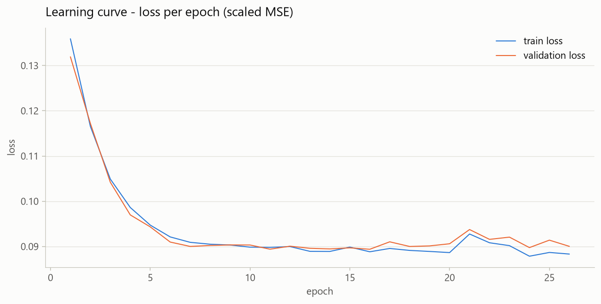

| Pattern | What it would look like | Ours? |
|---|---|---|
| **Underfitting** (too simple) | both losses stay high | No: both drop from ~0.13 to ~0.09 |
| **Overfitting** (memorising) | train keeps falling, validation turns up | No: gap only +0.0006 at the best epoch |
| **Good fit** | both low and close | ✔ |

The floor (~0.09, about 9% of the variance) is weather that 14 days of temperatures and a date cannot explain. More training can't remove it. Only new information can (section 8).

### 6.4 The saved model
`models/lstm.npz` holds `W, b, Wy, by` (1,297 numbers), the scaler's means and standard deviations, the feature names and the best epoch. Step 5 loads it without retraining.

---

## 7. Model evaluation

### 7.1 Metrics

| Metric | Formula | Meaning |
|---|---|---|
| **MAE** (mean absolute error) | mean(\|y − ŷ\|) | the typical miss in °C; easy to explain |
| **RMSE** (root mean squared error) | √mean((y − ŷ)²) | like MAE, but big misses count extra; always ≥ MAE |
| **R²** (coefficient of determination) | 1 − Σ(y − ŷ)² / Σ(y − ȳ)² | share of the variation explained (1 = perfect, 0 = no better than the mean) |

### 7.2 Results on the test set (731 unseen days, 2008–2009)

| Model | MAE °C | RMSE °C | R² |
|---|---|---|---|
| Tomorrow = today (persistence) | 1.680 | 2.178 | 0.883 |
| Average of the last 14 days | 2.423 | 3.026 | 0.774 |
| Linear regression (same 14 days, flattened to 42 numbers) | 1.624 | 2.097 | 0.892 |
| **LSTM (16 memory cells)** | **1.587** | **2.035** | **0.898** |
| *Week 5 feedforward network* | *1.620* | *2.069* | *0.895* |
| *Week 2 gradient boosting* | *1.63* | | |

**Honest reading:**
- The LSTM beats persistence by **5.5%**, so it learned something real.
- It is the best model so far on these inputs, but only by **~0.03–0.04 °C** (~2%) over linear regression and Week 5's network. Step 6 shows that just changing the random start of training moves a score by ~0.03 °C, so this is a **small edge, not a breakthrough**.
- Four very different models (trees, feedforward, linear, LSTM) land within 0.05 °C of each other. As in Week 5, the limit is the **information in the inputs**, not the model.

### 7.3 Error analysis

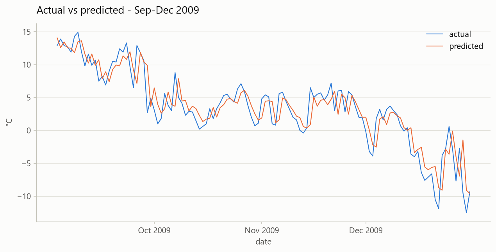

The prediction follows the level and the autumn cooling, but it is **smoother** than reality and reacts to sudden changes **one day late**. It only knows the past, so it can't see a cold front coming.

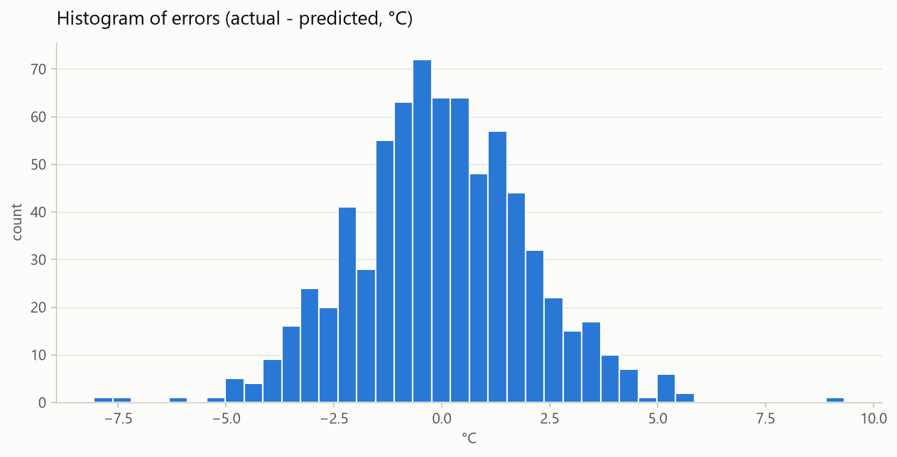

- Mean error **−0.01 °C**: no systematic bias.
- **40%** of days within ±1 °C, **86%** within ±3 °C.
- Worst miss **9.3 °C** on 2009-01-09, a sudden winter change (the same day Week 5's network missed most).

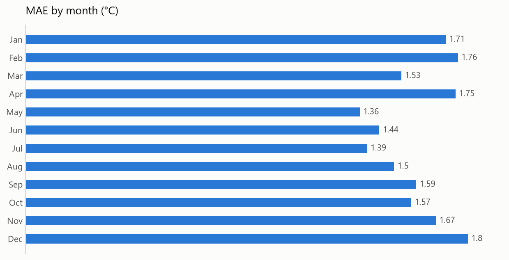

| Month | Jan | Feb | Mar | Apr | May | Jun | Jul | Aug | Sep | Oct | Nov | Dec |
|---|---|---|---|---|---|---|---|---|---|---|---|---|
| MAE °C | 1.71 | 1.76 | 1.53 | 1.75 | **1.36** | 1.44 | 1.39 | 1.50 | 1.59 | 1.57 | 1.67 | **1.80** |

Winter is hardest: cold snaps and mild Atlantic air swing the night minimum by ~10 °C. April is also hard (spring frosts after mild days).

### 7.4 Looking inside: which of the 14 days does the LSTM use?

**Sensitivity** = |dŷ/dx|: how much the prediction moves when one input day's temperature moves. We get it from the same backward pass, by sending in "1" instead of the loss gradient and reading the gradient for the inputs.

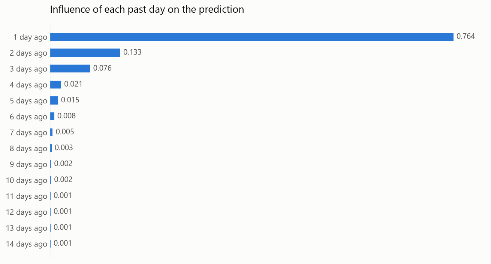

- **Yesterday alone: 74%** of the total influence. The last 3 days: **94%**. Days 8–14: **1%**.
- The LSTM discovered on its own what the de-seasonalised autocorrelation showed in step 1 (section 2.3): the weather's memory is short. Its forget gates let older days fade.
- This explains the honest result in 7.2. An LSTM's superpower is *long* memory, and this task barely needs it.

---

## 8. How to improve the model

### 8.1 What we tried (step 6). Every decision was made on **validation** data

| Experiment (one change at a time) | Validation MAE °C |
|---|---|
| Baseline: 16 cells, 14 days, lr 0.005 | 1.740 |
| Smaller memory: 4 cells | 1.741 |
| Bigger memory: 64 cells | 1.732 |
| Slower learning rate 0.001 | 1.749 |
| Faster learning rate 0.02 | 1.754 |
| Shorter sequence: 7 days | 1.728 |
| Longer sequence: 30 days | 1.758 |
| **+ weather on every day** (temp_mean, temp_max, pressure, cloud_cover, sunshine, precipitation → 9 features per day) | **1.445** |
| **Ensemble of 5 LSTMs** (+ weather), different random starts | **1.409** ← winner |
| PyTorch `nn.LSTM` (+ weather), same settings | 1.418 |

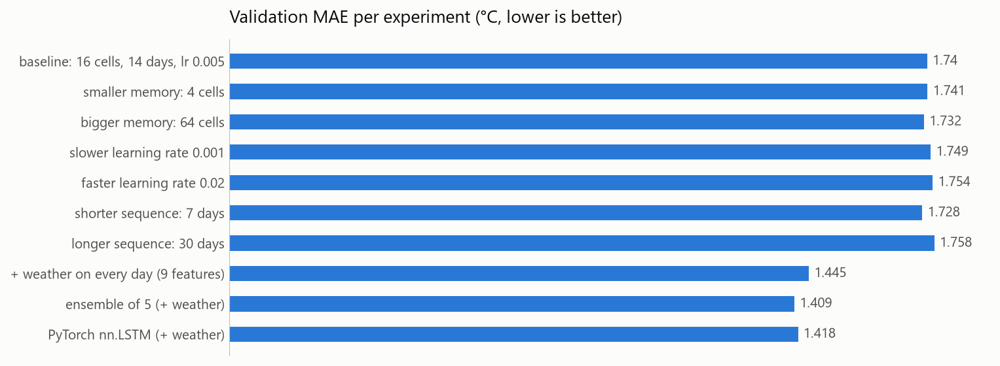

- **Memory size, learning rate, sequence length: no real gain** (all within 1.728–1.758, which is noise). This matches 7.4: the model uses ~3 days, so 7 vs 14 vs 30 makes no difference.
- **New information: −0.30 °C.** Each day's clouds, sunshine and pressure describe the *weather situation* (a clear, calm winter night is a cold night), which the temperature sequence alone cannot show.
- **Ensemble: another −0.04 °C.** The five LSTMs (1.442–1.471, a spread of 0.029 °C from the random start alone) make slightly different mistakes, and averaging cancels part of them.
- **PyTorch** gets the same quality in ~25 lines. `loss.backward()` (automatic differentiation, "autograd") replaces our entire `backward()` method.

### 8.2 The winner meets the test set, once

| Model (test 2008–2009) | MAE °C | RMSE °C | R² |
|---|---|---|---|
| Persistence | 1.680 | 2.178 | 0.883 |
| LSTM baseline (step 5) | 1.587 | 2.035 | 0.898 |
| Linear regression + weather (14 days × 9 = 126 inputs) | 1.334 | 1.721 | 0.927 |
| *Week 5 best: ensemble of 5 feedforward networks + yesterday's weather* | *1.312* | *1.700* | *0.929* |
| **Ensemble of 5 LSTMs + weather** | **1.297** | **1.682** | **0.930** |

**From 1.59 to 1.30 °C, 18% better**, almost all of it from better **inputs**. The LSTM ensemble is the best model of the course so far, but it's ahead of linear regression by only 0.037 °C and of Week 5's best by only 0.015 °C.

### 8.3 The lessons
1. **Data and features first, model type later.** One good new input beat every architecture change, and it beat switching from a feedforward network to an LSTM.
2. **Always keep a simple baseline.** Without the linear-regression row, the LSTM would look like a big step forward.
3. **Match the model to the memory the problem needs.** Weather here "remembers" ~3 days. An LSTM earns its complexity when long-range order matters: language, speech, sensor streams, multi-week patterns.
4. **Tune on validation, test once.**

### 8.4 More improvement ideas, ranked by expected impact

| # | Idea | Why it could help |
|---|---|---|
| 1 | Neighbouring cities' weather on every day (Oslo, Malmö) | Weather moves west → east; this is real *new information*, and sequences are the natural way to see it arriving |
| 2 | **Multi-day forecasts** (predict days t … t+6) | Errors compound over the horizon; here memory and order matter much more than for one day ahead |
| 3 | Predict the **change** (today − yesterday) | Persistence is built in; the model focuses on what's hard |
| 4 | Retrain on train + validation (2000–2007) with the chosen settings | 33% more data, settings already fixed |
| 5 | **Probabilistic output** (e.g. 10th–90th percentile, as in DeepAR) | "−2 to +4 °C" is more honest than "+1 °C" in winter |
| 6 | Stacked LSTM (2 layers), **GRU**, dropout | Matters on harder tasks; little to gain on a 3-day pattern |

---

## 9. Evolution, current state, open problems

### 9.1 Evolution of the idea

| Year | Milestone | Problem it solved |
|---|---|---|
| 1986–90 | Recurrent networks (Rumelhart et al.; Jordan; **Elman**) and **BPTT** (Werbos, 1990) | neural networks for sequences: a loop with a hidden state, trained by unrolling |
| 1991–94 | **Vanishing gradient** identified (Hochreiter's thesis, 1991; Bengio et al., 1994) | explained *why* RNNs couldn't learn long-range dependencies |
| **1997** | **LSTM** (Hochreiter & Schmidhuber) | the cell state and "constant error carousel": gradients survive hundreds of steps |
| 2000 | **Forget gate** added (Gers, Schmidhuber & Cummins) | the original LSTM could only add to memory; now it can also reset it. This is the LSTM we built |
| 2005–09 | Bidirectional LSTM, CTC; handwriting-recognition wins (Graves) | LSTMs beat other methods on real sequence tasks |
| 2013 | Deep LSTMs for speech recognition (Graves et al.) | big jumps in speech accuracy |
| 2014 | **Seq2seq** (Sutskever et al.), **GRU** (Cho et al.), **attention** (Bahdanau et al.) | translating whole sentences; a simpler gated cell; looking back at any input step |
| 2015–17 | LSTMs in production: Google voice search and Translate (GNMT, 2016), Apple QuickType, Amazon Alexa | LSTMs power everyday products |
| 2017 | **DeepAR** (Amazon) | probabilistic forecasting with an LSTM trained across many related series |
| 2017 | **Transformer** ("Attention Is All You Need") | no recurrence: whole sequences processed in parallel on GPUs; replaced LSTMs in language |
| 2018 | M4 forecasting competition won by **ES-RNN** (Smyl, Uber) | a hybrid of exponential smoothing + LSTM beat pure statistics and pure ML |
| 2019 | LSTMs for river-flow prediction (Kratzert et al.) | beat traditional hydrology models; led to Google's flood forecasting |
| 2021 | Temporal Fusion Transformer | an LSTM encoder + attention, for interpretable multi-horizon forecasts |
| 2023–24 | **State-space models / Mamba**, RWKV, **xLSTM** (Hochreiter's group), minLSTM/minGRU | recurrent ideas return: linear-time like an RNN, trainable in parallel like a Transformer |
| 2024 | Global flood forecasting (Nearing et al., *Nature*) | LSTM-based forecasts of extreme floods in ungauged rivers, used in Google Flood Hub |

### 9.2 Current state (2026)
- **Language:** Transformers have replaced LSTMs almost completely. Recurrent ideas are coming back as efficient alternatives (Mamba-style state-space models, xLSTM) for very long sequences.
- **Time series:** LSTMs and GRUs remain solid, well-understood workhorses, especially for **streaming** data (sensors, IoT, on-device), where you update a small state per new reading instead of re-reading the whole history. For big collections of series, deep models (N-HiTS, TFT, PatchTST) and pretrained **time-series foundation models** (TimesFM, Chronos, Moirai) are common. Gradient boosting and linear models remain strong baselines.
- **Tools:** PyTorch `nn.LSTM` / `nn.GRU`; Keras `layers.LSTM`; forecasting libraries Darts, Nixtla `neuralforecast`, GluonTS (DeepAR), PyTorch Forecasting. In the browser: TensorFlow.js `tf.layers.lstm` and ONNX Runtime Web. On mobile: Core ML and LiteRT (TensorFlow Lite).

### 9.3 Open problems & active debates
- **Parallelism vs memory:** an RNN must process day 13 before day 14, which is slow on GPUs. Transformers parallelise but cost grows with the square of the sequence length. Can we have both? (Mamba, xLSTM, linear RNNs.)
- **When do deep sequence models beat simple baselines?** Our result (a ~2% edge) is typical. Claims of big wins often shrink against well-tuned linear models (Zeng et al., 2023).
- **Long-range memory in practice:** LSTMs help, but real-world memory still fades after a few hundred steps.
- **Uncertainty:** most networks output one number. Calibrated forecast ranges are still hard.
- **Distribution shift and extremes:** climate change; rare events have the least training data and matter most.
- **Interpretability:** gates are inspectable, but 64 gate signals × 14 days is not an explanation. Sensitivity (section 7.4) is a first step.

---

## 10. Why this matters for my roles

### Software engineer
- **A stateful model.** At inference you can keep `(h, c)` between calls and feed only the newest day: O(1) work per update. That's how streaming and on-device models work, and it's ordinary state management. You persist, version and reset it like session state.
- **The data contract is stricter.** Sequences need evenly spaced, gap-free, correctly ordered timestamps. Timezone bugs, duplicated rows and daylight-saving days become model bugs.
- **Test the maths.** Gradient checks and "same output as the reference library" tests (step 3) are real engineering practices for ML code.

### Web / frontend developer
- **Inference in the browser:** the forward pass is ~10 lines (section 5.2). With TensorFlow.js or ONNX Runtime Web, a 1,297-parameter LSTM runs instantly, offline.
- **Mental model:** an LSTM is `days.reduce(cell, {c, h})`, a reducer whose update rules are learned. Typing prediction, gesture recognition and "next action" suggestions use the same pattern over keystrokes and events.
- **Ship the scaler and the window with the model.** The client must apply the same `(x − mean)/std` and send exactly 14 days in the right order, oldest first.

### UI/UX designer
- **Show uncertainty and the lag.** The model reacts one day late to sudden changes, and 14% of days miss by more than 3 °C. A shaded range and a link to official warnings set honest expectations.
- **Explain with what the model really uses:** "mostly based on the last 3 days, plus yesterday's sky and pressure" (section 7.4) is true, and it builds more trust than "AI-powered".
- **Sequence-aware UX:** products built on recurrent models (autocomplete, smart replies) feel best when suggestions are easy to ignore and update smoothly as each new input arrives.

---

## 11. Glossary

| Term | Plain meaning |
|---|---|
| **Sequence / time step** | an ordered list of items / one position in it (here: one day) |
| **Feature vector** | the numbers describing one time step (here: 3, or 9 with weather) |
| **RNN (recurrent neural network)** | a network with a loop that processes a sequence step by step, passing a hidden state along |
| **Hidden state h** | the RNN's/LSTM's short-term memory and per-step output |
| **Cell state c** | the LSTM's long-term memory, changed only by "multiply by a gate, then add" |
| **Gate** | a learned valve between 0 and 1 (a sigmoid) that controls how much passes through |
| **Forget / input / output gate** | how much old memory to keep / new info to write / memory to show |
| **Candidate g** | the new information the cell could write (tanh, −1..1) |
| **Sigmoid σ / tanh** | S-shaped squashing functions to (0, 1) / (−1, 1) |
| **Unrolling** | drawing the loop as a chain of copies, one per time step |
| **Weight sharing** | the same weights used at every time step |
| **BPTT** | backpropagation through time: the chain rule applied backwards over the unrolled steps |
| **Vanishing / exploding gradient** | the learning signal shrinks to ~0 / grows huge as it travels back through many steps |
| **Constant error carousel** | the LSTM's additive cell-state path that lets gradients survive many steps |
| **Gradient clipping** | shrinking a too-long gradient to a maximum length |
| **Adam** | an optimiser that gives every weight its own step size from running averages of its gradients |
| **Many-to-one** | read a whole sequence, output one value at the end |
| **Concatenate [a, b]** | glue two vectors side by side |
| **Sliding window** | turning a long series into overlapping fixed-length samples |
| **Standardization** | rescale to mean 0, std 1 using training statistics |
| **Validation set** | data used during development to stop training and choose settings, never to fit weights |
| **Early stopping** | stop when validation loss stops improving; keep the best weights |
| **Data leakage** | the model sees information it wouldn't have in real use |
| **Persistence baseline** | "tomorrow = today" |
| **Ensemble** | averaging several models' predictions |
| **Sensitivity / saliency** | how much the output changes when one input changes (\|dŷ/dx\|) |
| **Autograd** | a library (PyTorch) computing the backward pass automatically |
| **GRU** | gated recurrent unit: a simpler LSTM variant with 2 gates and no separate cell state |

---

## 12. Check my understanding

<details><summary>1. What is the shape of X_train and what does each axis mean?</summary>
(2178, 14, 3): 2,178 samples, 14 days (time steps) per sample, 3 features per day.</details>

<details><summary>2. Why doesn't a longer window add parameters to an LSTM, but did to Week 5's network?</summary>
The LSTM reuses the same W and b on every day (weight sharing). Week 5's network had one input column, and so one set of weights, per lag.</details>

<details><summary>3. In the worked example, why did the forget gate get zero gradient on day 1?</summary>
df = dL/dc · c_prev, and c_prev = c₀ = 0. There was nothing to forget, so its setting couldn't have affected the loss.</details>

<details><summary>4. Why can an LSTM learn from 14 days ago when a simple RNN can't?</summary>
Going back one step along the cell state multiplies the error signal only by the forget gate (which can stay near 1), not by a weight × tanh′ that is usually well below 1. 0.95¹⁴ ≈ 0.49 vs 0.48¹⁴ ≈ 0.00003.</details>

<details><summary>5. Why are W's gradients ADDED over the 14 days?</summary>
The same W is used on every day, so every day's use contributes to the loss. By the chain rule, the total slope is the sum of the contributions.</details>

<details><summary>6. What would happen without scaling the inputs?</summary>
Large raw values push sigmoid/tanh onto their flat parts, so the gradients are ≈ 0 and the gates can't learn. Inputs of very different sizes would also need very different step sizes.</details>

<details><summary>7. The LSTM beat linear regression by only ~0.04 °C. Why, and what would make an LSTM shine?</summary>
The useful memory is ~3 days and almost linear (section 7.4), so a straight line captures most of it. LSTMs shine when long-range order matters: language, speech, multi-step forecasts, or long sensor streams.</details>

<details><summary>8. Why did the first validation sample (1 Jan 2006) use training days as inputs, and why is that OK?</summary>
Its 14-day window is late December 2005. On 1 Jan 2006 you would really know those days. Leakage would be using an answer from the validation/test period for training.</details>

<details><summary>9. Why is validation used for early stopping and model choice, but test only once?</summary>
Every decision made with a dataset makes its score slightly optimistic. Keeping the test set untouched keeps its score an honest estimate of performance on truly new days.</details>

---

## 13. References
- Huber, F. et al. *Weather prediction dataset* (2022). GitHub: https://github.com/florian-huber/weather_prediction_dataset · Zenodo (CC BY 4.0): https://doi.org/10.5281/zenodo.7525955
- Klein Tank, A.M.G. et al. (2002). Daily dataset of 20th-century surface air temperature and precipitation series for the European Climate Assessment. *Int. J. Climatol.* 22, 1441–1453. Data: https://www.ecad.eu
- Hochreiter, S., Schmidhuber, J. (1997). Long Short-Term Memory. *Neural Computation* 9(8), 1735–1780.
- Gers, F., Schmidhuber, J., Cummins, F. (2000). Learning to Forget: Continual Prediction with LSTM. *Neural Computation* 12(10).
- Bengio, Y., Simard, P., Frasconi, P. (1994). Learning long-term dependencies with gradient descent is difficult. *IEEE Trans. Neural Networks* 5(2).
- Werbos, P. (1990). Backpropagation through time: what it does and how to do it. *Proc. IEEE* 78(10).
- Elman, J. (1990). Finding structure in time. *Cognitive Science* 14(2).
- Jozefowicz, R., Zaremba, W., Sutskever, I. (2015). An Empirical Exploration of Recurrent Network Architectures. *ICML*.
- Kingma, D., Ba, J. (2015). Adam: A Method for Stochastic Optimization. *ICLR*.
- Pascanu, R., Mikolov, T., Bengio, Y. (2013). On the difficulty of training recurrent neural networks (gradient clipping). *ICML*.
- Cho, K. et al. (2014). Learning Phrase Representations using RNN Encoder–Decoder (GRU). *EMNLP*.
- Olah, C. (2015). Understanding LSTM Networks. https://colah.github.io/posts/2015-08-Understanding-LSTMs/
- Salinas, D. et al. (2020). DeepAR: Probabilistic forecasting with autoregressive recurrent networks. *Int. J. Forecasting* 36(3).
- Smyl, S. (2020). A hybrid method of exponential smoothing and recurrent neural networks for time series forecasting. *Int. J. Forecasting* 36(1).
- Kratzert, F. et al. (2019). Towards learning universal, regional, and local hydrological behaviors via machine learning applied to large-sample datasets. *Hydrol. Earth Syst. Sci.* 23.
- Nearing, G. et al. (2024). Global prediction of extreme floods in ungauged watersheds. *Nature* 627.
- Beck, M. et al. (2024). xLSTM: Extended Long Short-Term Memory. *NeurIPS*.
- Gu, A., Dao, T. (2023). Mamba: Linear-Time Sequence Modeling with Selective State Spaces. arXiv:2312.00752.
- Zeng, A. et al. (2023). Are Transformers Effective for Time Series Forecasting? *AAAI*.
- Goodfellow, I., Bengio, Y., Courville, A. (2016). *Deep Learning*, ch. 10 (Sequence Modeling: Recurrent and Recursive Nets). https://www.deeplearningbook.org
- Hyndman, R.J., Athanasopoulos, G. *Forecasting: Principles and Practice* (3rd ed.). https://otexts.com/fpp3/
